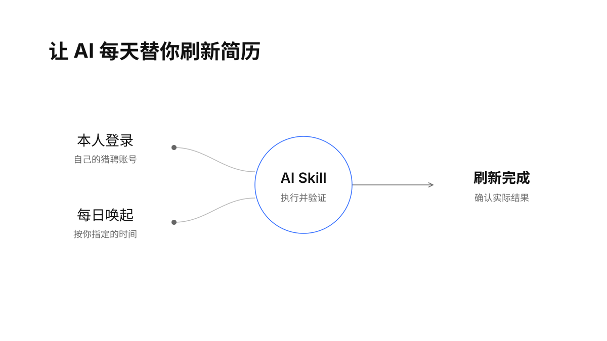
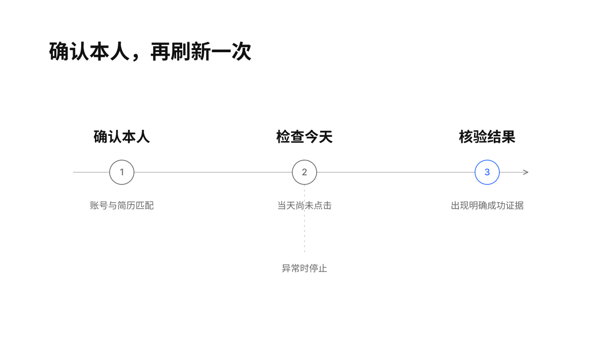
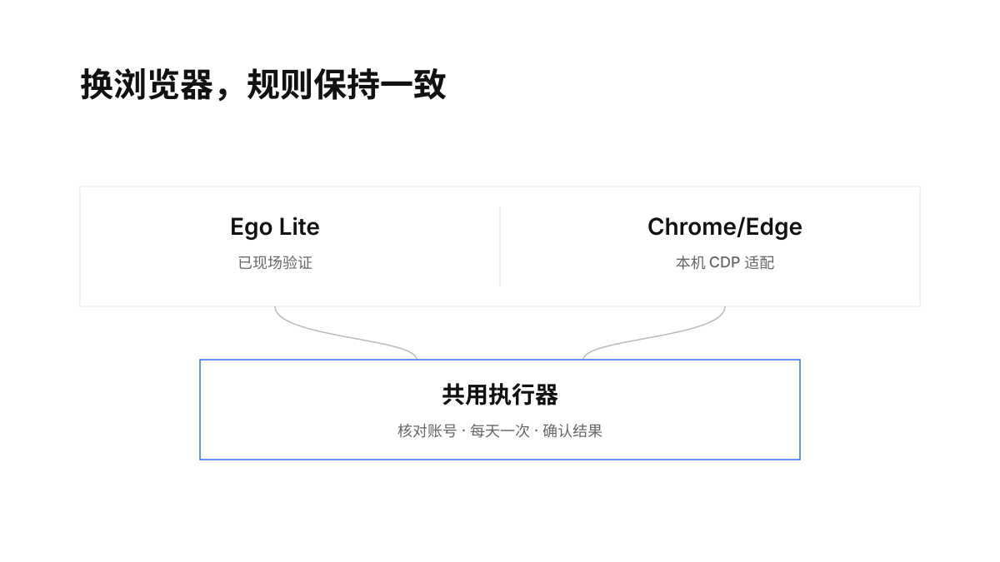

> “Civilization advances by extending the number of important operations which we can perform without thinking about them.”
> — Alfred North Whitehead, [An Introduction to Mathematics, Chapter V](https://introtologic.info/AboutLogicsite/whitehead%20Good%20Notation.html), 1911

<h1 align="center">猎聘简历每日刷新</h1>

<p align="center">
  
  <a href="LICENSE"></a>
  
  <a href="https://github.com/TongyiDai/liepin-resume-refresh/actions/workflows/ci.yml"></a>
</p>

<p align="center">让 AI 按时替你刷新猎聘简历，保持求职活跃。</p>

候选人在自己的电脑上登录猎聘，AI 核对账号、完成一次真实验证，再创建每日任务。到点后，AI 唤起 skill，执行原生刷新并检查结果。默认每天上午 09:03，可改为自己的时间。

<p align="center">
  
</p>

## 安装与使用

安装到支持 Agent Skills 的工具中：

```bash
npx skills add TongyiDai/liepin-resume-refresh
```

也可以下载 [Release 安装包](https://github.com/TongyiDai/liepin-resume-refresh/releases)，解压后将 `liepin-resume-refresh` 文件夹放进自己的 Agent skill 目录，例如 `~/.agents/skills/`。需要 Python 3.9+ 和可连接的电脑浏览器。

对 AI 说：

```text
用 $liepin-resume-refresh 配置我的猎聘账号，
让 AI 每天上午 9 点左右替我刷新简历。
```

第一次由本人输入密码、扫码或短信验证码。AI 会检查免费刷新入口、绑定本人账号和目标简历，并验证一次真实结果；完成后才启用每日任务。

之后可以继续说“查看猎聘刷新状态”“暂停自动刷新”“改到每天 10 点”“删除每日刷新任务”。切换账号或浏览器时重新验证。

## AI 如何按时执行

优先使用宿主的长期 AI 定时功能：每天唤起本 skill，读取本机配置与状态，再运行执行器。AI 负责配置、调度和异常处理，执行器负责核对身份、点击、去重和确认结果。

宿主没有长期定时功能时，可使用本机持久调度：macOS 使用用户级 LaunchAgent，Windows 使用当前用户的交互式计划任务。两种方式共用同一套状态记录，只注册一种调度。

完整的 [AI 每日提示词与注册步骤](references/agent-schedule.md) 和 [本机调度说明](references/scheduling.md) 均随 skill 提供。宿主必须能连接候选人自己的电脑；纯云端任务不能直接使用另一台电脑的浏览器登录态。

## 确认本人，每天刷新一次

执行前同时核对可见账号信息的摘要和加密简历 ID 的摘要。每个本地自然日最多派发一次点击；并发触发、已完成或暂停时跳过。成功必须有新的明确提示、原生刷新时间变化，或网页自己发出的刷新请求返回成功。

<p align="center">
  
</p>

登录过期、账号变化、验证码、付费要求或页面改版时停止。点击结果不明确时保留当天记录，等待本人核对。它只处理刷新状态；简历正文、求职状态、隐私设置、投递和消息另需授权。

默认在成功、暂停或今天已完成时保持安静；只有新的需要本人处理的异常，或异常恢复时通知。账号配置和执行日志留在本机，不放入仓库或发布包。

## 浏览器兼容

浏览器连接与刷新判断分离，使用同一套账号核对、每日去重和结果核验。优先复用本人可用的浏览器环境。

<p align="center">
  
</p>

| 浏览器 | 连接方式 | 验证范围 |
|---|---|---|
| [Ego Lite](https://github.com/citrolabs/ego-lite) | `ego-browser`，持续复用首次登录的专用任务空间 | 已完成 macOS 真实刷新与后台调度验证 |
| Chrome / Edge / Chromium | 本机 CDP 端口，Node.js 22+ | 已提供适配器并通过离线协议测试；目标浏览器需现场验证 |
| Firefox / Safari | 需要新增适配器 | 本版本未支持 |

[浏览器配置说明](references/browsers.md) 包含 CDP 的连接条件。电脑需要处于已登录状态，浏览器与登录会话可用；关机期间不能保证补跑。宿主定时能力取决于所用 AI 工具，不宣称所有 Agent 都提供长期后台调度。

## 为什么保留原生刷新入口

猎聘前端使用站内 `refresh-resume` 接口，但没有找到面向候选人的公开调用文档。普通只读请求曾返回业务错误 `-1400`。本实现保留网页自己的认证和请求封装，点击免费原生入口，并观察网页原生请求的结果。

[猎聘金卡](https://c.liepin.com/vip/privilege) 也提供官方自动刷新权益。本 skill 使用候选人可见的免费入口，不开通付费功能。刷新能维持活跃度，实际曝光量和面试量的提升幅度尚未测量。

## 验证与演示

```bash
python3 scripts/test_refresh.py
python3 scripts/demo.py
```

测试覆盖账号变化、同日去重、暂停、点击中断、陈旧成功提示、调度切换与 CDP 连接协议。CI 在 Python 3.9 和 3.13，以及 macOS、Windows、Linux 的夹具环境中运行。测试不访问候选人账号，也不能替代浏览器中的现场验证。

下面是**离线演示**：浏览器结果使用模拟值，每日去重和暂停逻辑运行真实代码，不访问猎聘或创建定时任务。

<p align="center">
  
</p>

演示可用 [VHS](https://github.com/charmbracelet/vhs) 重建：`vhs assets/demo.tape`。设计与实现参考见 [prior-art.md](references/prior-art.md)。

## 许可

[MIT](LICENSE)。
